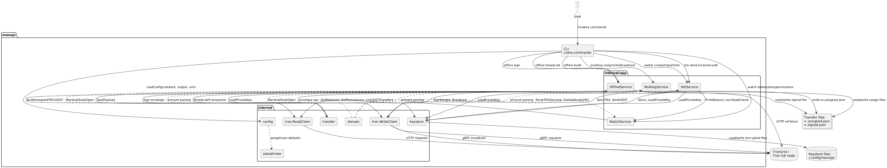

This text in [English](README.md) | [Русский](README.ru.md)

# Monujo

> In Open Source We Trust

Monujo estas minimuma **Go CLI** ilo por operacioj en la blokĉeno **Tron** kaj kun **USDT (TRC-20)**. Ĝi provizas sekuran administradon de kriptovalutoj kun pluraj operaciaj reĝimoj por konveni malsamajn sekurecajn postulojn.

## Trajtoj

- **Nur-lega reĝimo**: Kontrolu saldojn kaj transakcian historion por iu ajn Tron-adreso sen bezoni privatajn ŝlosilojn
- **Vivociklo de monujo**: Kreu aŭ importu monujajn dosierojn en loka ĉifrita ŝlosilujo, aŭ aldonu **eksterajn** nomitajn adresojn (`wallet import-external`) sen privataj ŝlosiloj (reto ne bezonata)
- **Varma monujo**: Reta sendado de TRX kaj USDT kun interaga konfirmo, uzante monujon el la ŝlosilujo
- **Senreta subskribado**: Aer-interspaca laborfluo por maksimuma sekureco kun la komandoj `build | sign | broadcast`
- **Plursubskriba partopreno**: Kune subskribu kaj elsendu Tron-plursubskribajn transakciojn konstruitajn de eksteraj kunordigantoj (`multisig cosign | info | broadcast`); inspektu permesojn per `watch permissions`
- **Subteno por pluraj retoj**: Funkcias kaj kun la ĉefa reto (mainnet) kaj kun la testreto Shasta
- **Sekura stokado**: Ĉifrita ŝlosilujo uzanta Argon2id + AES-256-GCM kun aŭtomata migrado de malnovaj formatoj
- **Ŝlosila administrado**: Kreu novajn monujojn aŭ importu ekzistantajn privatajn ŝlosilojn kun pasfraza protekto
- **Denaska subteno por TRC-20**: Enkonstruita subteno por USDT-transigoj kun fiksitaj kontraktadresoj

Desegnita por sekurec-konsciaj uzantoj, kiuj bezonas fidindajn operaciojn de kriptovalutoj sen la komplekseco de plenaj monujoj.

Minimuma **Go CLI** por **Tron / TRC-20 / USDT**: nur-legaj demandoj por malvarmaj adresoj (sen ŝlosiloj), **monujaj** vivociklaj komandoj por la loka ĉifrita ŝlosilujo, **varmaj monujaj** send-fluoj por retaj operacioj, kaj **aer-interspaca senreta subskribilo** (`monujo offline build|sign|broadcast`) por laborfluoj de malvarma stokado. Solana/BEP estas ekster amplekso.

## Diagramo de komponenta interago




## Konstruado

```bash
make build
# binaraĵo: build/monujo
```

Postulas Go 1.24+ (vidu `go.mod`).

## Agordado

| Medivariablo / flago                     | Celo                                                                             |
|------------------------------------------|----------------------------------------------------------------------------------|
| `MONUJO_TRONGRID_API_KEY` / `--api-key`  | Nedeviga TronGrid API-ŝlosilo (rekomendata por pli altaj limoj).                 |
| `MONUJO_KEYSTORE_DIR` / `--keystore-dir` | Dosierujo por monujaj dosieroj (defaŭlte: `~/.config/monujo/keystore`).          |
| `MONUJO_IMPORT_KEY`                      | Deksesuma privata ŝlosilo por `wallet import` se `--key-hex` estas preterlasita. |
| `--network`                              | `mainnet` (defaŭlte) aŭ `shasta` (testreto; USDT-kontrakto diferencas).          |
| `--output`                               | `table` aŭ `json`.                                                               |
| `--http-url` / `--grpc-url`              | Anstataŭigi TronGrid HTTP-bazan URL-on kaj gRPC `host:port`.                     |
| `--write-transport`                      | `rest` (defaŭlte, HTTPS) aŭ `grpc` (opt-in).                                       |
| `--grpc-url` / `--grpc-insecure`         | Nur kun `--write-transport grpc` (TronGrid gRPC estas plaintext).                  |
| `--force`                                | Preterpasi konfirmon pri ret-malkongruo ĉe subtenataj varmaj/senretaj operacioj. |

## Nur-lega (malvarma adreso, reta komputilo)

Neniuj privataj ŝlosiloj; uzas publikajn TronGrid HTTP-API-ojn.

```bash
./build/monujo watch balance --addr <TRON_BASE58_ADDRESS>
./build/monujo watch txs   --addr <TRON_BASE58_ADDRESS> [--limit 20]
```

## Administrado de monujoj (sen reto)

La grupo `wallet` administras la lokan ĉifritan ŝlosilujon (`~/.config/monujo/keystore` defaŭlte) sen tuŝi la reton Tron. La samaj dosieroj estas konsumataj de kaj `hot` (retaj operacioj sur ĉi tiu maŝino) kaj `offline sign` (aer-interspaca subskribado sur alia maŝino). **Nomoj de monujoj** devas uzi nur ASCII-literojn, ciferojn, `-` kaj `_`, kaj ne devas esti validaj Tron-base58-adresoj, por ke ili ne koliziu sur disko aŭ estu konfuzitaj kun valoroj `--addr` / `--from` / `--to` aliloke.

Listigi monujojn (nomo, tipo `local`/`external`, adreso, registritaj retoj):

```bash
./build/monujo wallet list [--output json]
```

1. **Krei** novan monujon loke (hazarda secp256k1-ŝlosilo, ĉifrita ŝlosilujo). La Tron-adreso estas derivita de la ŝlosilo; ĝi validas kaj en mainnet kaj en Shasta — elektu `--network` kiam vi demandas aŭ sendas; ĝi estas stokita en la metadatenoj de la monuja dosiero.

```bash
./build/monujo wallet create --name myhot [--network shasta]
# nedeviga: --export-private-key --allow-private-key-export (printas krudan deksesumon unufoje; nesekure)
# JSON kun nedeviga ŝlosila kampo: --output json --export-private-key --allow-private-key-export
# nedeviga: --generate-passphrase (vidu "Generilo de pasfrazoj" sube)
```

Enkonstruita generilo de pasfrazoj disponeblas kiel memstara komando `monujo tool genpass` kaj kiel `--generate-passphrase` ĉe `wallet create` / `wallet import`. Vortaroj: `english` (EFF Long, defaŭlta), `english-short`, `esperanto-x` (ASCII), `esperanto` (kun diakritaj signoj), `russian` (cirila). Vidu [docs/06-keystore.md](docs/06-keystore.md) §"Генератор парольных фраз" por detaloj, inkluzive de la avertoj printitaj por ne-ASCII-vortaroj kaj la preciza NFKC-semantiko.

1. **Importi** 64-deksesum-karakteran secp256k1-privatan ŝlosilon en ĉifritan dosieron (Argon2id + AES-256-GCM; malnovaj scrypt-dosieroj de antaŭ-v2-versioj estas aŭtomate migritaj ĉe la unua malŝloso):

```bash
./build/monujo wallet import --name myhot --key-hex <64_HEX_CHARS>
# pasfrazaj invitoj; aŭ agordu MONUJO_IMPORT_KEY anstataŭ --key-hex
```

1. **Importi eksteran** — konservi Tron-base58-adreson sub nomo (neniu privata ŝlosilo; montrita kiel `external` en `wallet list`). Uzu por saldo/ricevanto/konstru-kaŝnomoj; ne por subskribado.

```bash
./build/monujo wallet import-external --name custodian --addr <TRON_BASE58>
```

## Varma monujo (reta komputilo)

Ĉiu monuja dosiero stokas nedevigajn metadatenojn **`networks`**: kun kiuj Tron-retoj (`mainnet`, `shasta`) ĉi tiu monujo jam estis uzata. **`wallet create`** kaj **`wallet import`** registras la nunan `--network`. Post sukcesa **`hot send-trx`** aŭ **`hot send-usdt`**, la nuna reto estas aldonita se ĝi mankas.

Se vi rulas **`hot balance`**, **`hot send-trx`**, aŭ **`hot send-usdt`** kun `--network` kiu **ne** estas en tiu listo dum la listo **ne estas malplena**, la CLI printas la antaŭe registritajn retojn kaj petas konfirmon antaŭ la pasfraza invito (aŭ antaŭ salda serĉo por `hot balance`). En skriptoj aŭ sen TTY, pasu **`--force`** por agnoski la malkongruon, aŭ rulu interage kaj respondu `y`/`yes`.

1. **Unua TRX al nova adreso** (Tron-kontoj fariĝas videblaj por leg-API-oj post la unua alvenanta TRX). Sendu malgrandan kvanton el jam financita varma monujo:

```bash
./build/monujo hot send-trx --from funding --to <NEW_ADDR> --amount 1 --network shasta
```

(En testreto, vi povas uzi [Shasta-kranon](https://www.trongrid.io/faucet) anstataŭe.)

1. **Saldo** (neniu pasfrazo bezonata; monuja nomo solviĝas per ŝlosilujaj metadatenoj — inkluzive de **eksteraj** adres-nuraj kaŝnomoj — aŭ pasu iun ajn krudan base58-adreson; poste la samaj publikaj demandoj kiel `watch balance`):

```bash
./build/monujo hot balance --addr myhot
```

1. **Sendi TRX** (denaska, kvanto en sun/TRX-decimaloj):

```bash
./build/monujo hot send-trx --from myhot --to <ADDR> --amount 12.5
```

1. **Sendi USDT** (TRC-20; mainnet-kontrakto estas fiksita en la kodo):

```bash
./build/monujo hot send-usdt --from myhot --to <ADDR> --amount 10.25
```

Varmaj sendoj defaŭlte uzas **HTTPS REST** al TronGrid (`https://api.trongrid.io` en mainnet) kaj subskribas en-proceze. Por propra nodo aŭ legacy gRPC: `--write-transport grpc` (ofte kun `--grpc-insecure` por TronGrid aŭ loka `java-tron`). Vi bezonas sufiĉe da **TRX** por bendolarĝo/energio; USDT-transigoj konsumas energion.

## Sekurecaj notoj

- Ĉi tio **ne** estas aparatara monujo. Minacmodelo: fidinda konstruaĵo, fidinda maŝino, ĉifritaj ŝlosilujaj dosieraj permesoj (`0600`), forta pasfrazo, kaj nedeviga TronGrid API-ŝlosilo por fidindeco.
- **Ne** enmetu (commit) ŝlosilujojn, pasfrazojn, aŭ deksesumajn ŝlosilojn. `wallet import` subtenas medivariablon `MONUJO_IMPORT_KEY` por skriptado, sed medivariabloj kaj `--key-hex` povas liki tra procezaj metadatenoj. Evitu `wallet create --export-private-key --allow-private-key-export` krom se vi akceptas la riskon malkaŝi la ŝlosilon en la terminalo aŭ JSON-eligo.
- Kvanta analizo evitas `float64` por ĵetona matematiko; USDT/TRX-kvantoj estas traktataj kiel entjeroj / decimaloj per ĉenoj.
- USDT-kontraktadresoj: **mainnet** `TR7NHqjeKQxGTCi8q8ZY4pL8otSzgjLj6t`; **Shasta** uzas la test-ĵetonan adreson enkonstruitan en `internal/tron/constants.go` (ne la oficiala mainnet Tether).

## Senreta subskribado (aer-interspaco)

Por laborfluoj de malvarma stokado la ŝlosilujo povas vivi ekskluzive sur **senreta** maŝino. Tri komandoj portas transigon trans la aer-interspacon:

```bash
# Reta komputilo #1 (neniu ŝlosilujo bezonata): prenu freŝan ref-blokon, konstruu nesubskribitan transakcion
./build/monujo offline build \
    --from T...cold --to T...recipient \
    --amount 12.5 --kind trx \
    --out tx.unsigned.json \
    [--hmac-passphrase-env MONUJO_HMAC]

# Senreta komputilo (ŝlosilujo + privata ŝlosilo vivas ĈI TIE nur): subskribu la dosieron
./build/monujo offline sign \
    --in tx.unsigned.json --addr cold --out tx.signed.json \
    [--hmac-passphrase-env MONUJO_HMAC]

# Reta komputilo #2 (neniu ŝlosilujo bezonata): elsendu
./build/monujo offline broadcast --in tx.signed.json
```

`offline build --from` akceptas aŭ Tron-base58-adreson (T..., 34 signoj) aŭ, se ŝlosilujo ĉeestas sur ĉi tiu reta maŝino, monujan nomon el ĝi (loka aŭ **ekstera** kaŝnomo; neniu malĉifrado). `offline sign --addr` akceptas **lokan ĉifritan** monujan nomon aŭ base58-adreson kiu mapas al tia monujo (eksteraj kaŝnomoj estas malakceptitaj; subskribado bezonas privatan ŝlosilon).

Kaj TRX (`--kind trx`) kaj USDT (`--kind usdt`) estas subtenataj. La `ref_block` / `expiration` de Tron donas ~60-sekundan fenestron inter `build` kaj `broadcast`; eksvalidiĝinta dosiero devas esti rekonstruita rete.

`offline build`, `offline sign`, kaj `multisig cosign` rifuzas anstataŭigi ekzistantan `--out` dosieron krom se `--overwrite` estas pasita.

Du tavoloj protektas la dosieron dum transito:

- **Vida konfirmo.** Antaŭ subskribado kaj antaŭ elsendo, monujo rekalkulas ĉiujn home legeblajn kampojn (`from`, `to`, `amount`, `amount_minimal`, `contract`, `expiration`, `tx_id`) el la enigita `raw_data` kaj printas ilin kune kun la dosiera SHA-256, tiam demandas `[y/N]` (uzu `--yes` por skriptoj).
- **Nedeviga HMAC-SHA256.** Pasu `--hmac-passphrase` (aŭ `--hmac-passphrase-env`) ĉe ambaŭ finoj; la ŝlosilo estas derivita per scrypt kaj la koverto estas malakceptita ĉe malkongruo.

Vidu [docs/10-offline-commands.md](docs/10-offline-commands.md) por paŝ-post-paŝa gvidilo kaj la sur-diska koverta formato.

## Plursubskribo

Tron subtenas plursubskribon denaske (vidu `owner`/`witness`/`active` permesojn kun pezbalancitaj ŝlosiloj kaj `threshold`). La grupo `monujo multisig` permesas al monujo **partopreni** en plursubskriba transakcio kunmetita de ekstera kunordiganto (TronWeb/TronLink/TronScan/java-tron CLI): ĝi ne proponas novajn plursubskribajn transakciojn kaj ne agordas permesojn.

```bash
# kunsubskribanto #1 (senrete): aldonu subskribon al la envenanta dosiero
./build/monujo multisig cosign \
    --in tx.json --out tx.cosigned.json \
    --addr alice \
    [--format auto|tron-json|monujo] [--out-format ...] \
    [--hmac-passphrase-env MONUJO_HMAC]

# iu ajn (rete, nur-lege): inspektu la nunan subskriban pezon
./build/monujo multisig info --in tx.cosigned.json

# lasta kunsubskribanto (rete): elsendu kiam pezo >= sojlo
./build/monujo multisig broadcast --in tx.cosigned.json --yes
```

Kaj kanonika Tron JSON (la formato produktita de `tronWeb.trx.multiSign` kaj la HTTP API) kaj la `monujo` sigelita koverto (por aer-interspaca transito inter kunsubskribantoj) estas akceptitaj. Uzu `monujo watch permissions --addr T...` por printi la permesan strukturon de la konto, kun lokaj ŝlosilujaj monujoj emfazitaj por ke vi povu scii kiujn subskribojn vi mem povas kontribui.

Vidu [docs/13-multisig.md](docs/13-multisig.md) por la plena fluo, formataj detaloj kaj ne-celoj.

## Rompantaj ŝanĝoj (v0.x)

La CLI-surfaco ankoraŭ estas formata; dum la ĉefa versio estas `0.x` ni faras malmolajn renomojn sen konservi malrekomenditajn kaŝnomojn. Lastatempaj rompantaj ŝanĝoj:

- `monujo hot list|create|import` malaperis; ili moviĝis al `monujo wallet list|create|import`. La ĉifrita dosierformato estas senŝanĝa — nur la komandnomoj diferencas.
- **`--addr`** nomas la subjekton por komandoj sen `--to` ricevanto en la CLI: `hot balance`, `wallet check`, kaj `offline sign`. **`--from` / `--to`** estas uzataj por transigoj: `hot send-trx`, `hot send-usdt`, kaj `offline build`. Nomo vs base58-malambiguigo estas aŭtomata (sama heŭristiko kiel antaŭe).
- `hot balance` ne plu petas la ŝlosilujan pasfrazon. La adreso estas legata el la plarteksta metadateno de la monuja dosiero; integreco de la ĉifrita ŝlosilo ankoraŭ estas kontrolata la venontan fojon kiam vi subskribas ion.
- La aparta komando `hot activate` estis forigita; uzu `hot send-trx` por la sama efiko.

## Permesilo

Vidu la radikon de la deponejo / kontraŭfluajn dependecojn (gotron-sdk estas miksaĵo de LGPL/Apache; go-ethereum LGPL). Certigu plenumon se vi redistribuas binarojn.

## Starware

Monujo estas Starware :) Se vi ŝatas ĉi tiun projekton aŭ trovas ĝin utila, bonvolu konsideri doni al ĝi stelon ⭐ ĉe GitHub!
