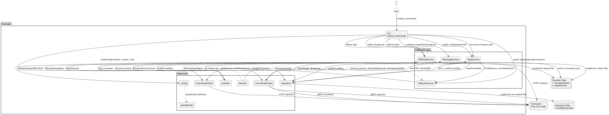

This text in [Esperanto](README.eo.md) | [Русский](README.ru.md)

# Monujo

> In Open Source We Trust

Monujo is a minimal **Go CLI** tool for **Tron blockchain** and **USDT (TRC-20)** operations. It provides secure cryptocurrency management with multiple operational modes to suit different security requirements.

## Features

- **Watch-only mode**: Query balances and transaction history for any Tron address without requiring private keys
- **Wallet lifecycle**: Create or import wallet files in a local encrypted keystore, or add **external** named addresses (`wallet import-external`) without private keys (no network required)
- **Hot wallet**: Online sending of TRX and USDT with interactive confirmation, using a wallet from the keystore
- **Offline signing**: Air-gapped workflow for maximum security with `build | sign | broadcast` commands
- **Multisig participation**: Cosign and broadcast Tron multisig transactions built by external coordinators (`multisig cosign | info | broadcast`); inspect permissions with `watch permissions`
- **Multi-network support**: Works with both mainnet and Shasta testnet
- **Secure storage**: Encrypted keystore using Argon2id + AES-256-GCM with automatic migration from legacy formats
- **Key management**: Create new wallets or import existing private keys with passphrase protection
- **Native TRC-20 support**: Built-in support for USDT transfers with fixed contract addresses

Designed for security-conscious users who need reliable cryptocurrency operations without the complexity of full wallets.

Minimal **Go CLI** for **Tron / TRC-20 / USDT**: watch-only queries for cold addresses (no keys), **wallet** lifecycle commands for the local encrypted keystore, **hot wallet** send flows for online operations, and an **air-gapped offline signer** (`monujo offline build|sign|broadcast`) for cold-storage workflows. Solana/BEP are out of scope.

## Component interaction diagram



## Build

```bash
make build
# binary: build/monujo
```

Requires Go 1.24+ (see `go.mod`).

## Configuration

| Env / flag                               | Purpose                                                                 |
|------------------------------------------|-------------------------------------------------------------------------|
| `MONUJO_TRONGRID_API_KEY` / `--api-key`  | Optional TronGrid API key (recommended for higher rate limits).         |
| `MONUJO_KEYSTORE_DIR` / `--keystore-dir` | Wallet files directory (default: `~/.config/monujo/keystore`).          |
| `MONUJO_IMPORT_KEY`                      | Hex private key for `wallet import` if `--key-hex` is omitted.          |
| `--network`                              | `mainnet` (default) or `shasta` (testnet; USDT contract differs).       |
| `--output`                               | `table` or `json`.                                                      |
| `--http-url`                             | Override TronGrid HTTP base URL (read + default write transport).       |
| `--write-transport`                      | `rest` (default, HTTPS Wallet API) or `grpc` (opt-in, gotron-sdk).      |
| `--grpc-url` / `--grpc-insecure`         | Used only with `--write-transport grpc` (TronGrid gRPC is plaintext).     |
| `--force`                                | Skip network-mismatch confirmation on supported hot/offline operations. |

## Watch-only (cold address, online PC)

No private keys; uses public TronGrid HTTP APIs.

```bash
./build/monujo watch balance --addr <TRON_BASE58_ADDRESS>
./build/monujo watch txs   --addr <TRON_BASE58_ADDRESS> [--limit 20]
```

## Wallet management (no network)

The `wallet` group manages the local encrypted keystore (`~/.config/monujo/keystore` by default) without touching the Tron network. The same files are consumed by both `hot` (online operations on this machine) and `offline sign` (air-gapped signing on a different machine). **Wallet names** must use only ASCII letters, digits, `-` and `_`, and must not be valid Tron base58 addresses, so they cannot collide on disk or be confused with `--addr` / `--from` / `--to` values elsewhere.

List wallets (name, type `local`/`external`, address, recorded networks):

```bash
./build/monujo wallet list [--output json]
```

1. **Create** a new wallet locally (random secp256k1 key, encrypted keystore). The Tron address is derived from the key; it is valid on both mainnet and Shasta — pick `--network` when you query or send; it is stored in the wallet file metadata.

```bash
./build/monujo wallet create --name myhot [--network shasta]
# optional: --export-private-key --allow-private-key-export (prints raw hex once; unsafe)
# JSON with optional key field: --output json --export-private-key --allow-private-key-export
# optional: --generate-passphrase (see "Passphrase generator" below)
```

A built-in passphrase generator is available as the standalone `monujo tool genpass` command and as `--generate-passphrase` on `wallet create` / `wallet import`. Dictionaries: `english` (EFF Long, default), `english-short`, `esperanto-x` (ASCII), `esperanto` (with diacritics), `russian` (Cyrillic). See [docs/06-keystore.md](docs/06-keystore.md) §"Генератор парольных фраз" for details, including the warnings printed for non-ASCII dictionaries and the exact NFKC semantics.

1. **Import** a 64-hex-character secp256k1 private key into an encrypted file (Argon2id + AES-256-GCM; legacy scrypt files from pre-v2 releases are auto-migrated on first unlock):

```bash
./build/monujo wallet import --name myhot --key-hex <64_HEX_CHARS>
# passphrase prompts; or set MONUJO_IMPORT_KEY instead of --key-hex
```

1. **Import external** — save a Tron base58 address under a name (no private key; shown as `external` in `wallet list`). Use for balance/recipient/build aliases; not for signing.

```bash
./build/monujo wallet import-external --name custodian --addr <TRON_BASE58>
```

## Hot wallet (online PC)

Each wallet file stores optional **`networks`** metadata: which Tron networks (`mainnet`, `shasta`) this wallet has already been used with. **`wallet create`** and **`wallet import`** record the current `--network`. After a successful **`hot send-trx`** or **`hot send-usdt`**, the current network is appended if missing.

If you run **`hot balance`**, **`hot send-trx`**, or **`hot send-usdt`** with a `--network` that is **not** in that list while the list is **non-empty**, the CLI prints the previously recorded networks and asks for confirmation before the passphrase prompt (or before balance lookup for `hot balance`). In scripts or without a TTY, pass **`--force`** to acknowledge the mismatch, or run interactively and answer `y`/`yes`.

1. **First TRX to a new address** (Tron accounts become visible to read APIs after the first incoming TRX). Send a small amount from an already-funded hot wallet:

```bash
./build/monujo hot send-trx --from funding --to <NEW_ADDR> --amount 1 --network shasta
```

(On testnet, you can use a [Shasta faucet](https://www.trongrid.io/faucet) instead.)

1. **Balance** (no passphrase needed; wallet name resolves via keystore metadata — including **external** address-only aliases — or pass any raw base58 address; then the same public queries as `watch balance`):

```bash
./build/monujo hot balance --addr myhot
```

1. **Send TRX** (native, amount in sun/TRX decimals):

```bash
./build/monujo hot send-trx --from myhot --to <ADDR> --amount 12.5
```

1. **Send USDT** (TRC-20; mainnet contract is fixed in code):

```bash
./build/monujo hot send-usdt --from myhot --to <ADDR> --amount 10.25
```

Hot sends use **HTTPS REST** to TronGrid by default (`https://api.trongrid.io` on mainnet: `/wallet/createtransaction`, `/wallet/triggersmartcontract`, `/wallet/broadcasthex`) and sign in-process. For legacy or custom full nodes, opt in with `--write-transport grpc` (and usually `--grpc-insecure` for TronGrid or local `java-tron`). You need enough **TRX** for bandwidth/energy; USDT transfers consume energy — fund the hot address accordingly.

## Security notes

- This is **not** a hardware wallet. Threat model: trusted build, trusted machine, encrypted keystore file permissions (`0600`), strong passphrase, and optional TronGrid API key for reliability.
- **Do not** commit keystores, passphrases, or hex keys. `wallet import` supports env `MONUJO_IMPORT_KEY` for scripting, but env and `--key-hex` can leak through process metadata. Avoid `wallet create --export-private-key --allow-private-key-export` unless you accept the risk of exposing the key in the terminal or JSON output.
- Amount parsing avoids `float64` for token math; USDT/TRX amounts are handled as integers / decimals via strings.
- USDT contract addresses: **mainnet** `TR7NHqjeKQxGTCi8q8ZY4pL8otSzgjLj6t`; **Shasta** uses the test token address baked into `internal/tron/constants.go` (not official mainnet Tether).

## Offline signing (air-gap)

For cold-storage workflows the keystore can live exclusively on an **offline** machine. Three commands carry a transfer across the air gap:

```bash
# Online PC #1 (no keystore needed): fetch a fresh ref-block, build unsigned tx
./build/monujo offline build \
    --from T...cold --to T...recipient \
    --amount 12.5 --kind trx \
    --out tx.unsigned.json \
    [--hmac-passphrase-env MONUJO_HMAC]

# Offline PC (keystore + private key live HERE only): sign the file
./build/monujo offline sign \
    --in tx.unsigned.json --addr cold --out tx.signed.json \
    [--hmac-passphrase-env MONUJO_HMAC]

# Online PC #2 (no keystore needed): broadcast
./build/monujo offline broadcast --in tx.signed.json
```

`offline build --from` accepts either a Tron base58 address (T..., 34 chars) or, if a keystore is present on this online machine, a wallet name from it (local or **external** alias; no decryption). `offline sign --addr` accepts a **local encrypted** wallet name or a base58 address that maps to such a wallet (external aliases are rejected; signing needs a private key).

Both TRX (`--kind trx`) and USDT (`--kind usdt`) are supported. Tron's `ref_block` / `expiration` give a ~60 second window between `build` and `broadcast`; an expired file must be rebuilt online.

`offline build`, `offline sign`, and `multisig cosign` refuse to replace an existing `--out` file unless `--overwrite` is passed.

Two layers protect the file in transit:

- **Visual confirmation.** Before signing and before broadcasting, monujo recomputes all human-readable fields (`from`, `to`, `amount`, `amount_minimal`, `contract`, `expiration`, `tx_id`) from the embedded `raw_data` and prints them along with the file SHA-256, then asks `[y/N]` (use `--yes` for scripts).
- **Optional HMAC-SHA256.** Pass `--hmac-passphrase` (or `--hmac-passphrase-env`) on both ends; the key is derived via scrypt and the envelope is rejected on mismatch.

See [docs/10-offline-commands.md](docs/10-offline-commands.md) for a step-by-step walk-through and the on-disk envelope format.

## Multisig

Tron supports multisig natively (see `owner`/`witness`/`active` permissions with weighted keys and a `threshold`). The `monujo multisig` group lets a wallet **participate** in a multisig transaction assembled by an external coordinator (TronWeb/TronLink/TronScan/java-tron CLI): it does not propose new multisig transactions and does not configure permissions.

```bash
# cosigner #1 (offline): append a signature to the incoming file
./build/monujo multisig cosign \
    --in tx.json --out tx.cosigned.json \
    --addr alice \
    [--format auto|tron-json|monujo] [--out-format ...] \
    [--hmac-passphrase-env MONUJO_HMAC]

# anyone (online, read-only): inspect the current sign weight
./build/monujo multisig info --in tx.cosigned.json

# last cosigner (online): broadcast when weight >= threshold
./build/monujo multisig broadcast --in tx.cosigned.json --yes
```

Both canonical Tron JSON (the format produced by `tronWeb.trx.multiSign` and the HTTP API) and the `monujo` sealed envelope (for air-gapped transit between cosigners) are accepted. Use `monujo watch permissions --addr T...` to print the permission structure of the account, with local keystore wallets highlighted so you can tell which signatures you can contribute yourself.

See [docs/13-multisig.md](docs/13-multisig.md) for the full flow, format details and non-goals.

## Breaking changes (v0.x)

The CLI surface is still being shaped; while the major version is `0.x` we do hard renames without keeping deprecated aliases. Recent breaking changes:

- `monujo hot list|create|import` are gone; they moved to `monujo wallet list|create|import`. The encrypted file format is unchanged — only the command names differ.
- **`--addr`** names the subject for commands without a `--to` recipient on the CLI: `hot balance`, `wallet check`, and `offline sign`. **`--from` / `--to`** are used for transfers: `hot send-trx`, `hot send-usdt`, and `offline build`. Name vs base58 disambiguation is automatic (same heuristic as before).
- `hot balance` no longer prompts for the keystore passphrase. The address is read from the plaintext metadata of the wallet file; integrity of the encrypted key is still verified the next time you sign anything.
- The separate `hot activate` command was removed; use `hot send-trx` for the same effect.

## License

See repository root / upstream dependencies (gotron-sdk is LGPL/Apache mix; go-ethereum LGPL). Ensure compliance if you redistribute binaries.

## Starware

Monujo is Starware :) If you like this utility and the code, consider giving it a star ⭐ on GitHub!
