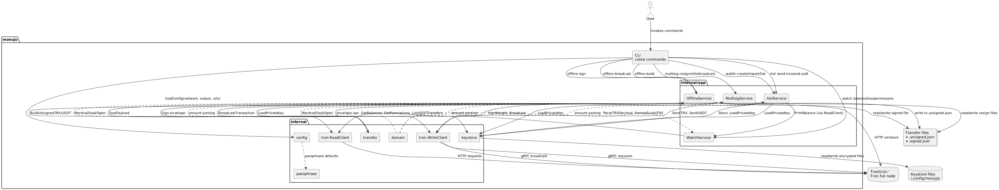

This text in [English](README.md) | [Esperanto](README.eo.md)

# Monujo

> In Open Source We Trust

Monujo — это минималистичная **Go CLI** утилита для работы с блокчейном **Tron** и **USDT (TRC-20)**. Она обеспечивает безопасное управление криптовалютой с несколькими режимами работы, подходящими под разные требования безопасности.

## Возможности

- **Режим только для чтения (watch-only)**: Запрос балансов и истории транзакций для любого адреса Tron без необходимости приватных ключей
- **Жизненный цикл кошелька**: Создание или импорт файлов кошелька в локальное зашифрованное хранилище ключей (keystore), или добавление **внешних** именованных адресов (`wallet import-external`) без приватных ключей (сеть не требуется)
- **Горячий кошелек**: Онлайн-отправка TRX и USDT с интерактивным подтверждением, используя кошелек из хранилища ключей
- **Офлайн-подписание**: Рабочий процесс с воздушным зазором (air-gapped) для максимальной безопасности с помощью команд `build | sign | broadcast`
- **Участие в мультисиге**: Совместное подписание и трансляция мультисиг-транзакций Tron, созданных внешними координаторами (`multisig cosign | info | broadcast`); проверка разрешений с помощью `watch permissions`
- **Поддержка нескольких сетей**: Работает как с основной сетью (mainnet), так и с тестовой сетью Shasta
- **Безопасное хранение**: Зашифрованное хранилище ключей с использованием Argon2id + AES-256-GCM с автоматической миграцией со старых форматов
- **Управление ключами**: Создание новых кошельков или импорт существующих приватных ключей с защитой парольной фразой
- **Встроенная поддержка TRC-20**: Встроенная поддержка переводов USDT с фиксированными адресами контрактов

Разработано для пользователей, заботящихся о безопасности, которым нужны надежные криптовалютные операции без сложности полных кошельков.

Минималистичный **Go CLI** для **Tron / TRC-20 / USDT**: запросы только для чтения для холодных адресов (без ключей), команды жизненного цикла **кошелька** для локального зашифрованного хранилища ключей, процессы отправки **горячего кошелька** для онлайн-операций и **офлайн-подписант с воздушным зазором** (`monujo offline build|sign|broadcast`) для рабочих процессов холодного хранения. Solana/BEP выходят за рамки проекта.

## Диаграмма взаимодействия компонентов




## Сборка

```bash
make build
# бинарный файл: build/monujo
```

Требуется Go 1.24+ (см. `go.mod`).

## Конфигурация

| Переменная / флаг | Назначение |
| --- | --- |
| `MONUJO_TRONGRID_API_KEY` / `--api-key` | Опциональный API-ключ TronGrid (рекомендуется для более высоких лимитов). |
| `MONUJO_KEYSTORE_DIR` / `--keystore-dir` | Директория файлов кошельков (по умолчанию: `~/.config/monujo/keystore`). |
| `MONUJO_IMPORT_KEY` | Hex-приватный ключ для `wallet import`, если опущен `--key-hex`. |
| `--network` | `mainnet` (по умолчанию) или `shasta` (тестовая сеть; контракт USDT отличается). |
| `--output` | `table` или `json`. |
| `--http-url` / `--grpc-url` | Переопределение базового URL TronGrid HTTP и gRPC `host:port`. |
| `--grpc-insecure` | Использование нешифрованного gRPC только для доверенных локальных/приватных нод. |
| `--force` | Пропуск подтверждения несовпадения сети в поддерживаемых горячих/офлайн операциях. |

## Только для чтения (холодный адрес, ПК с интернетом)

Без приватных ключей; использует публичные HTTP API TronGrid.

```bash
./build/monujo watch balance --addr <TRON_BASE58_ADDRESS>
./build/monujo watch txs   --addr <TRON_BASE58_ADDRESS> [--limit 20]
```

## Управление кошельками (без сети)

Группа `wallet` управляет локальным зашифрованным хранилищем ключей (по умолчанию `~/.config/monujo/keystore`) без обращения к сети Tron. Те же файлы используются как `hot` (онлайн-операции на этой машине), так и `offline sign` (офлайн-подписание на другой машине). **Имена кошельков** должны использовать только ASCII-буквы, цифры, `-` и `_`, и не должны быть валидными адресами Tron base58, чтобы они не конфликтовали на диске и не путались со значениями `--addr` / `--from` / `--to` в других местах.

Список кошельков (имя, тип `local`/`external`, адрес, записанные сети):

```bash
./build/monujo wallet list [--output json]
```

1. **Создать** новый кошелек локально (случайный ключ secp256k1, зашифрованное хранилище ключей). Адрес Tron выводится из ключа; он действителен как в mainnet, так и в Shasta — выбирайте `--network` при запросе или отправке; он сохраняется в метаданных файла кошелька.

```bash
./build/monujo wallet create --name myhot [--network shasta]
# опционально: --export-private-key --allow-private-key-export (выводит сырой hex один раз; небезопасно)
# JSON с опциональным полем ключа: --output json --export-private-key --allow-private-key-export
# опционально: --generate-passphrase (см. "Генератор парольных фраз" ниже)
```

Встроенный генератор парольных фраз доступен как отдельная команда `monujo tool genpass` и как `--generate-passphrase` в `wallet create` / `wallet import`. Словари: `english` (EFF Long, по умолчанию), `english-short`, `esperanto-x` (ASCII), `esperanto` (с диакритикой), `russian` (кириллица). См. [docs/06-keystore.md](docs/06-keystore.md) §"Генератор парольных фраз" для подробностей, включая предупреждения, выводимые для не-ASCII словарей, и точную семантику NFKC.

1. **Импортировать** 64-символьный hex-приватный ключ secp256k1 в зашифрованный файл (Argon2id + AES-256-GCM; старые файлы scrypt из релизов до v2 автоматически мигрируют при первой разблокировке):

```bash
./build/monujo wallet import --name myhot --key-hex <64_HEX_CHARS>
# запросы парольной фразы; или задайте MONUJO_IMPORT_KEY вместо --key-hex
```

1. **Импортировать внешний** — сохранить адрес Tron base58 под именем (без приватного ключа; отображается как `external` в `wallet list`). Используйте для алиасов баланса/получателя/сборки; не для подписания.

```bash
./build/monujo wallet import-external --name custodian --addr <TRON_BASE58>
```

## Горячий кошелек (ПК с интернетом)

Каждый файл кошелька хранит опциональные метаданные **`networks`**: с какими сетями Tron (`mainnet`, `shasta`) этот кошелек уже использовался. **`wallet create`** и **`wallet import`** записывают текущую `--network`. После успешного **`hot send-trx`** или **`hot send-usdt`** текущая сеть добавляется, если ее там нет.

Если вы запускаете **`hot balance`**, **`hot send-trx`** или **`hot send-usdt`** с `--network`, которой **нет** в этом списке, в то время как список **не пуст**, CLI выводит ранее записанные сети и запрашивает подтверждение перед запросом парольной фразы (или перед проверкой баланса для `hot balance`). В скриптах или без TTY передайте **`--force`**, чтобы подтвердить несовпадение, или запустите интерактивно и ответьте `y`/`yes`.

1. **Первый TRX на новый адрес** (аккаунты Tron становятся видимыми для API чтения после первого входящего TRX). Отправьте небольшую сумму с уже пополненного горячего кошелька:

```bash
./build/monujo hot send-trx --from funding --to <NEW_ADDR> --amount 1 --network shasta
```

(В тестовой сети вы можете использовать [кран Shasta](https://www.trongrid.io/faucet) вместо этого.)

1. **Баланс** (парольная фраза не нужна; имя кошелька разрешается через метаданные хранилища ключей — включая **внешние** алиасы только для адресов — или передайте любой сырой адрес base58; затем те же публичные запросы, что и `watch balance`):

```bash
./build/monujo hot balance --addr myhot
```

1. **Отправить TRX** (нативный, сумма в sun/TRX-десятичных):

```bash
./build/monujo hot send-trx --from myhot --to <ADDR> --amount 12.5
```

1. **Отправить USDT** (TRC-20; контракт mainnet фиксирован в коде):

```bash
./build/monujo hot send-usdt --from myhot --to <ADDR> --amount 10.25
```

Горячие отправки используют **gRPC поверх TLS** к полной ноде Tron (по умолчанию `grpc.trongrid.io:50051` в mainnet) и подписывают внутри процесса. Используйте `--grpc-insecure` только для доверенных локальных/приватных нод. Вам нужно достаточно **TRX** для bandwidth/energy; переводы USDT потребляют energy — пополняйте горячий адрес соответственно.

## Заметки по безопасности

- Это **не** аппаратный кошелек. Модель угроз: доверенная сборка, доверенная машина, права доступа к зашифрованному файлу хранилища ключей (`0600`), сильная парольная фраза и опциональный API-ключ TronGrid для надежности.
- **Не** коммитьте хранилища ключей, парольные фразы или hex-ключи. `wallet import` поддерживает переменную окружения `MONUJO_IMPORT_KEY` для скриптов, но переменные окружения и `--key-hex` могут утечь через метаданные процесса. Избегайте `wallet create --export-private-key --allow-private-key-export`, если вы не принимаете риск раскрытия ключа в терминале или JSON-выводе.
- Парсинг сумм избегает `float64` для математики токенов; суммы USDT/TRX обрабатываются как целые числа / десятичные дроби через строки.
- Адреса контрактов USDT: **mainnet** `TR7NHqjeKQxGTCi8q8ZY4pL8otSzgjLj6t`; **Shasta** использует адрес тестового токена, вшитый в `internal/tron/constants.go` (не официальный mainnet Tether).

## Офлайн-подписание (воздушный зазор)

Для рабочих процессов холодного хранения хранилище ключей может находиться исключительно на **офлайн** машине. Три команды переносят перевод через воздушный зазор:

```bash
# Онлайн ПК #1 (хранилище ключей не нужно): получить свежий ref-block, собрать неподписанную транзакцию
./build/monujo offline build \
    --from T...cold --to T...recipient \
    --amount 12.5 --kind trx \
    --out tx.unsigned.json \
    [--hmac-passphrase-env MONUJO_HMAC]

# Офлайн ПК (хранилище ключей + приватный ключ живут ТОЛЬКО ЗДЕСЬ): подписать файл
./build/monujo offline sign \
    --in tx.unsigned.json --addr cold --out tx.signed.json \
    [--hmac-passphrase-env MONUJO_HMAC]

# Онлайн ПК #2 (хранилище ключей не нужно): транслировать в сеть
./build/monujo offline broadcast --in tx.signed.json
```

`offline build --from` принимает либо адрес Tron base58 (T..., 34 символа), либо, если на этой онлайн-машине присутствует хранилище ключей, имя кошелька из него (локальный или **внешний** алиас; без расшифровки). `offline sign --addr` принимает имя **локального зашифрованного** кошелька или адрес base58, который соответствует такому кошельку (внешние алиасы отклоняются; для подписания нужен приватный ключ).

Поддерживаются как TRX (`--kind trx`), так и USDT (`--kind usdt`). `ref_block` / `expiration` Tron дают окно ~60 секунд между `build` и `broadcast`; просроченный файл должен быть пересобран онлайн.

`offline build`, `offline sign` и `multisig cosign` отказываются заменять существующий файл `--out`, если не передан флаг `--overwrite`.

Два слоя защищают файл при передаче:

- **Визуальное подтверждение.** Перед подписанием и перед трансляцией monujo пересчитывает все человекочитаемые поля (`from`, `to`, `amount`, `amount_minimal`, `contract`, `expiration`, `tx_id`) из встроенного `raw_data` и выводит их вместе с SHA-256 файла, затем спрашивает `[y/N]` (используйте `--yes` для скриптов).
- **Опциональный HMAC-SHA256.** Передайте `--hmac-passphrase` (или `--hmac-passphrase-env`) на обоих концах; ключ выводится через scrypt, и конверт отклоняется при несовпадении.

См. [docs/10-offline-commands.md](docs/10-offline-commands.md) для пошагового руководства и формата конверта на диске.

## Мультисиг

Tron поддерживает мультисиг нативно (см. разрешения `owner`/`witness`/`active` с взвешенными ключами и `threshold`). Группа `monujo multisig` позволяет кошельку **участвовать** в мультисиг-транзакции, собранной внешним координатором (TronWeb/TronLink/TronScan/java-tron CLI): она не предлагает новые мультисиг-транзакции и не настраивает разрешения.

```bash
# подписант #1 (офлайн): добавить подпись к входящему файлу
./build/monujo multisig cosign \
    --in tx.json --out tx.cosigned.json \
    --addr alice \
    [--format auto|tron-json|monujo] [--out-format ...] \
    [--hmac-passphrase-env MONUJO_HMAC]

# любой (онлайн, только чтение): проверить текущий вес подписей
./build/monujo multisig info --in tx.cosigned.json

# последний подписант (онлайн): транслировать, когда вес >= порогу
./build/monujo multisig broadcast --in tx.cosigned.json --yes
```

Принимаются как каноничный Tron JSON (формат, создаваемый `tronWeb.trx.multiSign` и HTTP API), так и запечатанный конверт `monujo` (для передачи через воздушный зазор между подписантами). Используйте `monujo watch permissions --addr T...` для вывода структуры разрешений аккаунта, с выделенными локальными кошельками из хранилища ключей, чтобы вы могли определить, какие подписи вы можете внести сами.

См. [docs/13-multisig.md](docs/13-multisig.md) для полного процесса, деталей формата и не-целей.

## Критические изменения (v0.x)

Поверхность CLI все еще формируется; пока мажорная версия `0.x`, мы делаем жесткие переименования без сохранения устаревших алиасов. Недавние критические изменения:

- `monujo hot list|create|import` исчезли; они переместились в `monujo wallet list|create|import`. Зашифрованный формат файла не изменился — отличаются только имена команд.
- **`--addr`** называет субъект для команд без получателя `--to` в CLI: `hot balance`, `wallet check` и `offline sign`. **`--from` / `--to`** используются для переводов: `hot send-trx`, `hot send-usdt` и `offline build`. Разрешение неоднозначности имя vs base58 происходит автоматически (та же эвристика, что и раньше).
- `hot balance` больше не запрашивает парольную фразу хранилища ключей. Адрес читается из открытых метаданных файла кошелька; целостность зашифрованного ключа по-прежнему проверяется при следующем подписании чего-либо.
- Отдельная команда `hot activate` была удалена; используйте `hot send-trx` для того же эффекта.

## Лицензия

См. корень репозитория / зависимости (gotron-sdk — это смесь LGPL/Apache; go-ethereum — LGPL). Обеспечьте соблюдение, если вы распространяете бинарные файлы.

## Starware

Monujo — это Starware :) Если тебе понравилась программа и её код, внеси ⭐ в качестве оплаты — поставь звезду на Github!
