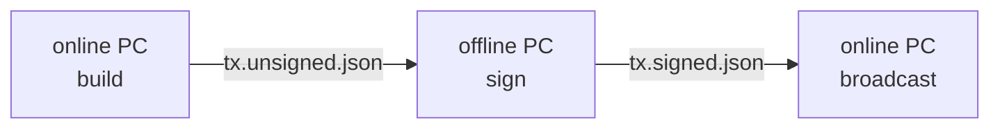

# 10. `offline` commands (air-gap signing)

The `monujo offline` group implements the classic three-step offline
signing flow for Tron transfers (TRX and USDT TRC-20):

1. **online PC #1** — `offline build` assembles an unsigned transaction
   and writes a JSON envelope.
2. **offline PC** — `offline sign` verifies and signs the file using
   an encrypted keystore that lives **only** on that machine.
3. **online PC #2** — `offline broadcast` shows the transaction fields
   again, asks for confirmation, and submits it to the network over
   HTTPS REST (`/wallet/broadcasthex` by default).



## Key isolation

The encrypted keystore file with the private key lives only on the
**offline machine**. On the online PCs where `build` and `broadcast`
run, you do **not** need it and should not keep it — otherwise an
attacker who compromises the online PC can copy the file and attempt
offline password cracking.

- `offline build` takes the sender via the unified `--from` flag and
  the recipient via `--to`. Both flags use the same heuristic: if the
  value validates as a Tron base58 address (T..., 34 characters) —
  it is an address; otherwise — a keystore file name (including an
  **external** `import-external` entry), and the command resolves the
  address via `keystore.ListWallets` without decryption. On an online
  machine there is usually no keystore, so an address is used; `--to`
  by name is convenient when the recipient is a local or external
  alias.
- `offline sign` is the only command that needs `--keystore-dir` and
  the keystore password. Its **`--addr`** accepts either the name of a
  **local** encrypted wallet, or a base58 address that is resolved to
  a name via `keystore.ListWallets` (without decryption).
  **`import-external` entries are rejected** before the passphrase
  prompt: signing needs a private key. If the given address matches no
  local wallet, the command exits with an error and asks you to pass a
  name instead of an address. The address from the decrypted key is
  always checked against the `from` field in the payload; on mismatch
  signing is not performed.
- `offline broadcast` again does not require a keystore.

## Transaction lifetime window

Tron includes `ref_block_*` and `expiration` fields in `raw_data`
(≈ 60 seconds from build time). If you do not sign and broadcast
within that window, broadcast returns a `TAPOS expired` error — you
need a new `build`. This is a deliberate constraint of the offline
scenario: you get Tron’s guarantee that a transaction cannot be “put
on the shelf” and sent a week later.

## Protection against file tampering in transit

Between online and offline the file passes through media that cannot
be fully trusted (USB stick, cloud, etc.). Two independent protection
layers apply:

1. **Visual verification.** Before signing and before broadcast monujo:
   - re-decodes `raw_data` from the payload and parses the contract
     (TRX TransferContract or TRC-20 transfer(address,uint256));
   - compares the resulting `from` / `to` / `amount` / `contract` /
     `expiration` with those declared in the payload — and **refuses
     to proceed** if the values diverge;
   - prints all fields plus the SHA-256 of the envelope file itself to
     stderr;
   - asks `[y/N]` (or accepts `--yes`).

   `offline build` applies the same comparison to the transaction the
   node returned, before the envelope is written. `offline sign` and
   `offline broadcast` also refuse a payload whose `raw_data` is not a
   plain transfer: non-zero `call_value` or `call_token_value`, a
   TRC-10 `token_id`, a transaction memo, or a TRC-20 contract other
   than the canonical USDT token for `--network`.
2. **HMAC-SHA256 (optional).** If you set
   `--hmac-passphrase` or `--hmac-passphrase-env <NAME>` on all three
   commands, the envelope gets an `hmac_hex` — HMAC-SHA256 of
   `payload_b64` keyed by `scrypt(passphrase, "monujo-offline-v1",
   N=32768, r=8, p=1, 32)`. On the receiving side the HMAC is checked
   before fields are shown; on mismatch the file is rejected. HMAC
   protects integrity but **not secrecy**: better to convey the
   passphrase out of band (voice, SMS, a separate secure messenger),
   not via the file itself.

## Envelope file format

The same outer JSON is used for unsigned and signed files; the HMAC
covers exactly the bytes on disk:

```json
{
  "monujo": "monujo-offline",
  "kind": "unsigned_transfer",
  "version": 1,
  "payload_b64": "<base64 of the canonical JSON encoding of the payload structure>",
  "hmac_alg": "scrypt+hmac-sha256",
  "hmac_hex": "<optional>"
}
```

The payload itself is a strictly ordered JSON structure (see
`internal/transfer/envelope.go`):

- **UnsignedTransferPayload**: `version, chain, kind, from, to, amount,
  amount_minimal, contract, fee_limit_sun, raw_data_hex, expiration_unix_ms,
  timestamp_unix_ms, tx_id_hex, created_at_unix, note`. What is signed is
  `raw_data_hex` (protobuf `core.TransactionRaw`); all other fields
  are for visual checks and must match what is decoded from
  `raw_data_hex`.
- **SignedTransferPayload**: a subset of the same fields plus
  `signature_hex` (65-byte recoverable ECDSA, hex with a `0x` prefix).

## Example: TRX

```bash
# online PC #1 (no keystore)
./monujo offline build \
    --from TMuA6YqfCeX8EhbfYEg5y7S4DqzSJireY9 \
    --to T9yD14Nj9j7xAB4dbGeiX9h8unkKHxuWwb \
    --kind trx --amount 12.5 \
    --out tx.unsigned.json \
    --hmac-passphrase-env MONUJO_HMAC

# offline PC (has keystore, has private key)
./monujo offline sign \
    --in tx.unsigned.json --addr cold --out tx.signed.json \
    --hmac-passphrase-env MONUJO_HMAC
# > enter the keystore password, read the parsed fields, answer y

# online PC #2 (no keystore)
./monujo offline broadcast \
    --in tx.signed.json --hmac-passphrase-env MONUJO_HMAC
# > fields again, y → broadcast OK
```

## Example: USDT (gas top-up)

`offline` supports USDT: pass `--kind usdt` and the amount in USDT
decimals. By default `fee_limit_sun` comes from monujo’s configuration
(`DefaultFeeLimitSun`; can be changed via a `--fee-limit-sun` flag in
a future extension). On mainnet the canonical contract
`TR7NHqjeKQxGTCi8q8ZY4pL8otSzgjLj6t` is used; on Shasta — the test
token.

```bash
./monujo offline build \
    --from T...cold --to T...recipient \
    --kind usdt --amount 25.50 \
    --out usdt.unsigned.json
```

## Confirmations and `--yes`

`offline sign` and `offline broadcast` by default wait for `y`/`yes`
in the terminal. For scripts pass `--yes`. If standard input is not
attached to a terminal and `--yes` is not set, the command stops with
an error (same logic as `confirmWalletNetworkForOperation` for `hot`
commands).

## Networks

`offline build` takes the network from the global `--network` and
embeds it in the payload `chain` field (`tron:mainnet` or
`tron:shasta`). On the `sign`/`broadcast` side the global `--network`
must also match `chain`, otherwise the command refuses to run. This is
an extra safeguard against accidentally sending a mainnet transfer
through a Shasta node.

## Limitations

- Offline USDT covers only the
  `transfer(address,uint256)` method on the canonical USDT contract of
  the current network; other TRC-20 / other methods are out of scope
  for this milestone.
- One file — one transaction (one contract in `raw_data`); batch
  transfers are not supported.
- There is no ref-block “snapshot” for long-lived signing: the
  60-second window is a Tron property, not a configuration parameter.
