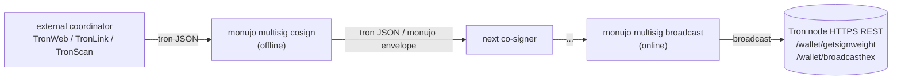

# 13. `multisig` commands (participating in Tron multisig transactions)

Tron supports multisig natively: every account has
`owner_permission` (id=0), an optional `witness_permission` (id=1), and
up to eight `active_permission` entries (id=2..9). Each permission
lists a `threshold` and `{address, weight}` pairs. A transaction
references a specific permission via
`Transaction.Contract[i].Permission_id`; that field is part of the
hash, so `txID = sha256(raw_data)` changes when the permission
changes. Each co-signer **appends** their signature to
`Transaction.Signature` until the combined weight reaches `threshold`.

The `monujo multisig` group implements only **participation** in
multisig transactions already assembled by someone else: sign, inspect
status, and, if `threshold` is met, broadcast. Building the
transaction and configuring permissions
(`UpdateAccountPermissionContract`) is done by an external
coordinator — TronWeb/TronLink/TronScan/CLI java-tron — monujo
intentionally does not cover that side.



## File formats

The `cosign` / `broadcast` / `info` commands accept and emit two
formats:

1. **Canonical Tron JSON** — the same shape returned by the Tron HTTP
   API and `tronWeb.trx.multiSign`:

   ```json
   {
     "txID": "...",
     "raw_data": {...},
     "raw_data_hex": "...",
     "signature": ["<hex>", "<hex>", ...]
   }
   ```

   Valid/invalid `txID` is checked against the recomputed
   `sha256(raw_data_hex)`.

2. **Monujo sealed envelope** (`kind=multisig_transfer`) — a base64
   wrapper with a SHA-256 fingerprint and an optional HMAC-SHA256 on a
   passphrase. Used when moving a file between air-gap machines: a
   monitor on each side shows the fingerprint and human-readable fields
   (`from`, `to`, `amount`, `contract`, `fee_limit_sun`, `expiration`).

The `--format auto|tron-json|monujo` flag sets the input format. If
omitted, the format is detected automatically: if the JSON has a
`"monujo"` key — it is a sealed envelope, otherwise Tron JSON. For
`cosign`, a separate `--out-format` can change the output format (for
example, accept Tron JSON and return a `monujo` envelope for transfer
to an air-gap machine).

## Commands

### `monujo multisig cosign`

Offline. Accepts a multisig transaction, verifies `raw_data_hex`
against human-readable fields (for TRX and USDT — strict check with
refusal on mismatch; for other contracts — a warning and
confirmation), signs with a key from the keystore, and writes the
updated file. Refuses to place a second signature with the same key —
that would be an accidental double signature that on Tron simply does
not increase weight — unless `--force` is passed.

```bash
monujo multisig cosign \
  --in tx.json --out tx.cosigned.json \
  --addr alice \
  [--format auto|tron-json|monujo] [--out-format ...] \
  [--hmac-passphrase ... | --hmac-passphrase-env VAR] \
  [--yes] [--force] [--overwrite] [--note "for Acme LTD"]
```

The `--addr` flag accepts a keystore wallet name **or** a base58
address (the address is resolved via `keystore.ListWallets` without
decryption; if the address belongs to no local wallet — the command
errors and asks you to pass a name). The preview before confirmation
shows the transaction `permission_id` and the selected signer address.
Offline `cosign` cannot prove that the signer is in the permission
keys without talking to a node; before distributing files, verify this
via `watch permissions` or online `multisig info`. Keystore-network
match against the network in the envelope is checked; `--force`
bypasses the check (same semantics as in `offline sign`).

`--out` is not overwritten silently; replacing an existing file
requires an explicit `--overwrite`.

### `monujo multisig info`

Online read-only. Shows how many signatures are already accumulated,
the threshold, and who still needs to sign:

```bash
monujo multisig info --in tx.cosigned.json [--format ...] [--hmac-*]
```

Calls `/wallet/getsignweight` via HTTPS REST (or gRPC when opted in);
broadcast and signing are not performed. On REST, `getsignweight`
supports `TransferContract` and `TriggerSmartContract`; for other
types use `--write-transport grpc`.

### `monujo multisig broadcast`

Online. Pre-check via `GetTransactionSignWeight` — if
`current_weight < threshold`, broadcast is **not** performed, and a
diff is printed (who has already signed, who is still missing).
Otherwise the transaction is sent to the network via the write
transport (HTTPS REST by default).

```bash
monujo multisig broadcast \
  --in tx.cosigned.json \
  [--format ...] [--hmac-*] [--yes]
```

`--yes` is required for non-interactive scripts; as with `offline
broadcast`, printing the fingerprint and fields before the node call
matches across machines.

## Transaction lifetime window

Tron’s `raw_data.expiration` is typically ≈ 60 seconds from build
time. For multisig, where several signatures are needed and the file
moves between machines, this is a hard limit: if you miss the window —
the coordinator rebuilds the transaction, and all previous signatures
are invalidated (`txID` changes). `monujo multisig info` shows
`expiration` in UTC/ISO 8601 so you can see how much of the window
remains.

## Non-goals

- No `monujo multisig propose` — new multisig transactions are built
  by an external coordinator.
- No support for `UpdateAccountPermissionContract` — permission setup
  is done with TronLink/TronWeb/another tool.
- No new HTTP provider/gRPC client appears: the same `ReadClient` and
  write transport (`rest` or opt-in `grpc`) are used as for `watch`,
  `hot`, `offline`.
- `offline build/sign/broadcast` are **not** changed — they remain
  strictly about 1-of-1 transactions.

## See also

- [04. `watch` commands](04-watch-commands.md) — `watch permissions`
  shows the account permission structure and marks keys for which you
  have a local keystore wallet.
- [10. `offline` commands](10-offline-commands.md) — the analogous
  scenario for 1-of-1 air-gap signing.
