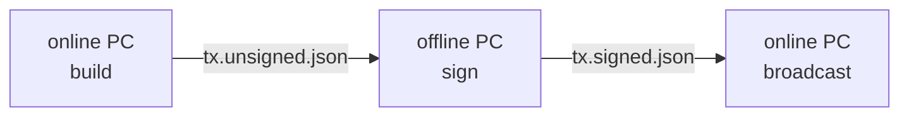

# 10. Komandoj `offline` (aer-interspaca subskribado)

La grupo `monujo offline` realigas la klasikan tripaŝan senretan
subskriban fluon por Tron-transigoj (TRX kaj USDT TRC-20):

1. **reta komputilo #1** — `offline build` kunmetas nesubskribitan transakcion
   kaj skribas JSON-koverton.
2. **senreta komputilo** — `offline sign` kontrolas kaj subskribas la dosieron uzante
   ĉifritan ŝlosilujon, kiu loĝas **nur** sur tiu maŝino.
3. **reta komputilo #2** — `offline broadcast` montras la transakciajn kampojn
   denove, petas konfirmon, kaj sendas ĝin al la reto per
   HTTPS REST (`/wallet/broadcasthex` defaŭlte).



## Izolo de ŝlosiloj

La ĉifrita ŝlosiluja dosiero kun la privata ŝlosilo loĝas nur sur la
**senreta maŝino**. Sur la retaj komputiloj, kie rulas `build` kaj `broadcast`,
vi **ne** bezonas ĝin kaj ne devas ĝin konservi — alie
atakanto, kiu kompromitas la retan komputilon, povas kopii la dosieron kaj provi
senretan fendadon de la pasvorto.

- `offline build` prenas la sendanton per la unuigita flago `--from` kaj
  la ricevanton per `--to`. Ambaŭ flagoj uzas la saman heŭristikon: se la
  valoro validas kiel Tron-base58-adreso (T..., 34 karakteroj) —
  ĝi estas adreso; alie — nomo de ŝlosiluja dosiero (inkluzive
  **eksteran** eron `import-external`), kaj la komando solvas la
  adreson per `keystore.ListWallets` sen deĉifrado. Sur reta
  maŝino kutime ne estas ŝlosilujo, do adreso estas uzata; `--to`
  laŭ nomo estas oportuna kiam la ricevanto estas loka aŭ ekstera
  kaŝnomo.
- `offline sign` estas la sola komando, kiu bezonas `--keystore-dir` kaj
  la ŝlosilujan pasvorton. Ĝia **`--addr`** akceptas aŭ la nomon de
  **loka** ĉifrita monujo, aŭ base58-adreson, kiu estas solvata al
  nomo per `keystore.ListWallets` (sen deĉifrado).
  **Eroj `import-external` estas rifuzataj** antaŭ la pasfraza
  invito: subskribado bezonas privatan ŝlosilon. Se la donita adreso kongruas kun nenia
  loka monujo, la komando eliras kun eraro kaj petas, ke vi pasigu
  nomon anstataŭ adreson. La adreso el la deĉifrita ŝlosilo
  ĉiam estas kontrolata kontraŭ la kampo `from` en la ŝarĝo; ĉe malkongruo
  subskribado ne okazas.
- `offline broadcast` denove ne postulas ŝlosilujon.

## Vivodaŭra fenestro de transakcio

Tron inkluzivas kampojn `ref_block_*` kaj `expiration` en `raw_data`
(≈ 60 sekundoj de la tempo de konstruo). Se vi ne subskribas kaj elsendas
ene de tiu fenestro, elsendo redonas eraron `TAPOS expired` — vi
bezonas novan `build`. Tio estas intenca limigo de la senreta
scenaro: vi ricevas la garantiion de Tron, ke transakcio ne povas esti «metita
sur la breton» kaj sendita semajnon poste.

## Protekto kontraŭ manipulado de dosieroj dum transporto

Inter reta kaj senreta la dosiero pasas tra medioj, kiujn oni ne povas
plene fidi (USB-bastono, nubo, ktp.). Du sendependaj protektaj
tavoloj aplikiĝas:

1. **Vida kontrolo.** Antaŭ subskribado kaj antaŭ elsendo monujo:
   - remalkodas `raw_data` el la ŝarĝo kaj analizas la kontrakton
     (TRX TransferContract aŭ TRC-20 transfer(address,uint256));
   - komparas la rezultajn `from` / `to` / `amount` / `contract` /
     `expiration` kun tiuj deklaritaj en la ŝarĝo — kaj **rifuzas
     daŭrigi** se la valoroj malsamas;
   - printas ĉiujn kampojn plus la SHA-256 de la koverta dosiero mem al
     stderr;
   - petas `[y/N]` (aŭ akceptas `--yes`).

   `offline build` aplikas la saman komparon al la transakcio, kiun la
   nodo redonis, antaŭ ol la koverto estas skribita. `offline sign` kaj
   `offline broadcast` ankaŭ rifuzas ŝarĝon, kies `raw_data` ne estas
   simpla translokigo: ne-nula `call_value` aŭ `call_token_value`,
   TRC-10 `token_id`, memorando de transakcio, aŭ TRC-20-kontrakto alia
   ol la kanona USDT-ĵetono por `--network`.
2. **HMAC-SHA256 (nedeviga).** Se vi agordas
   `--hmac-passphrase` aŭ `--hmac-passphrase-env <NAME>` ĉe ĉiuj tri
   komandoj, la koverto ricevas `hmac_hex` — HMAC-SHA256 de
   `payload_b64` kun ŝlosilo `scrypt(passphrase, "monujo-offline-v1",
   N=32768, r=8, p=1, 32)`. Sur la riceva flanko la HMAC estas kontrolata
   antaŭ ol kampoj estas montrataj; ĉe malkongruo la dosiero estas rifuzata. HMAC
   protektas integrecon sed **ne sekretecon**: pli bone transdonu la
   pasfrazon eksterbande (voĉe, SMS, aparta sekura mesaĝilo),
   ne per la dosiero mem.

## Formato de la koverta dosiero

La sama ekstera JSON estas uzata por nesubskribitaj kaj subskribitaj dosieroj; la HMAC
kovras ĝuste la bajtojn sur disko:

```json
{
  "monujo": "monujo-offline",
  "kind": "unsigned_transfer",
  "version": 1,
  "payload_b64": "<base64 of the canonical JSON encoding of the payload structure>",
  "hmac_alg": "scrypt+hmac-sha256",
  "hmac_hex": "<optional>"
}
```

La ŝarĝo mem estas strikte ordigita JSON-strukturo (vidu
`internal/transfer/envelope.go`):

- **UnsignedTransferPayload**: `version, chain, kind, from, to, amount,
  amount_minimal, contract, fee_limit_sun, raw_data_hex, expiration_unix_ms,
  timestamp_unix_ms, tx_id_hex, created_at_unix, note`. Kio estas subskribata estas
  `raw_data_hex` (protobuf `core.TransactionRaw`); ĉiuj aliaj kampoj
  estas por vidaj kontroloj kaj devas kongrui kun tio, kio estas malkodita el
  `raw_data_hex`.
- **SignedTransferPayload**: subaro de la samaj kampoj plus
  `signature_hex` (65-bajta restaŭrebla ECDSA, deksesume kun prefikso `0x`).

## Ekzemplo: TRX

```bash
# online PC #1 (no keystore)
./monujo offline build \
    --from TMuA6YqfCeX8EhbfYEg5y7S4DqzSJireY9 \
    --to T9yD14Nj9j7xAB4dbGeiX9h8unkKHxuWwb \
    --kind trx --amount 12.5 \
    --out tx.unsigned.json \
    --hmac-passphrase-env MONUJO_HMAC

# offline PC (has keystore, has private key)
./monujo offline sign \
    --in tx.unsigned.json --addr cold --out tx.signed.json \
    --hmac-passphrase-env MONUJO_HMAC
# > enter the keystore password, read the parsed fields, answer y

# online PC #2 (no keystore)
./monujo offline broadcast \
    --in tx.signed.json --hmac-passphrase-env MONUJO_HMAC
# > fields again, y → broadcast OK
```

## Ekzemplo: USDT (gasplenigo)

`offline` subtenas USDT: pasigu `--kind usdt` kaj la kvanton en USDT-
decimaloj. Defaŭlte `fee_limit_sun` venas el la agordo de monujo
(`DefaultFeeLimitSun`; ŝanĝebla per flago `--fee-limit-sun` en
estonta etendo). Sur mainnet la kanona kontrakto
`TR7NHqjeKQxGTCi8q8ZY4pL8otSzgjLj6t` estas uzata; sur Shasta — la test-
ĵetono.

```bash
./monujo offline build \
    --from T...cold --to T...recipient \
    --kind usdt --amount 25.50 \
    --out usdt.unsigned.json
```

## Konfirmoj kaj `--yes`

`offline sign` kaj `offline broadcast` defaŭlte atendas `y`/`yes`
en la terminalo. Por skriptoj pasigu `--yes`. Se la norma enigo ne
estas ligita al terminalo kaj `--yes` ne estas agordita, la komando haltas kun
eraro (sama logiko kiel `confirmWalletNetworkForOperation` por `hot`-
komandoj).

## Retoj

`offline build` prenas la reton el la globala `--network` kaj
enmetas ĝin en la kampon `chain` de la ŝarĝo (`tron:mainnet` aŭ
`tron:shasta`). Sur la flanko de `sign`/`broadcast` la globala `--network`
ankaŭ devas kongrui kun `chain`, alie la komando rifuzas ruliĝi. Tio estas
aldona protekto kontraŭ hazarde sendi mainnet-transigon
tra Shasta-nodo.

## Limigoj

- Senreta USDT kovras nur la metodon
  `transfer(address,uint256)` sur la kanona USDT-kontrakto de
  la nuna reto; aliaj TRC-20 / aliaj metodoj estas ekster amplekso
  por ĉi tiu mejloŝtono.
- Unu dosiero — unu transakcio (unu kontrakto en `raw_data`); grupaj
  transigoj ne estas subtenataj.
- Ne ekzistas «momentfoto» de ref-bloko por longdaŭra subskribado: la
  60-sekunda fenestro estas eco de Tron, ne agorda parametro.
