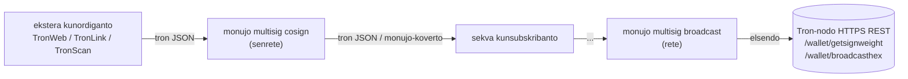

# 13. Komandoj `multisig` (partopreno en Tron-plursubskribaj transakcioj)

Tron denaske subtenas plursubskribon: ĉiu konto havas
`owner_permission` (id=0), nedevigan `witness_permission` (id=1), kaj
ĝis ok enskribojn `active_permission` (id=2..9). Ĉiu permeso
listigas `threshold` kaj parojn `{address, weight}`. Transakcio
referencas specifan permeson per
`Transaction.Contract[i].Permission_id`; tiu kampo estas parto de la
haketo, do `txID = sha256(raw_data)` ŝanĝiĝas kiam la permeso
ŝanĝiĝas. Ĉiu kunsubskribanto **aldonas** sian subskribon al
`Transaction.Signature` ĝis la kunigita pezo atingas `threshold`.

La grupo `monujo multisig` realigas nur **partoprenon** en
plursubskribaj transakcioj jam kunmetitaj de iu alia: subskribi,
inspekti staton, kaj, se `threshold` estas atingita, elsendi.
Konstruado de la transakcio kaj agordo de permesoj
(`UpdateAccountPermissionContract`) estas farataj de ekstera
kunordiganto — TronWeb/TronLink/TronScan/CLI java-tron — monujo
intence ne kovras tiun flankon.



## Dosierformatoj

La komandoj `cosign` / `broadcast` / `info` akceptas kaj eligas du
formatojn:

1. **Kanona Tron-JSON** — la sama formo redonata de la Tron-HTTP-API
   kaj `tronWeb.trx.multiSign`:

   ```json
   {
     "txID": "...",
     "raw_data": {...},
     "raw_data_hex": "...",
     "signature": ["<hex>", "<hex>", ...]
   }
   ```

   Valida/nevalida `txID` estas kontrolata kontraŭ la rekomputita
   `sha256(raw_data_hex)`.

2. **Monuja sigelita koverto** (`kind=multisig_transfer`) — base64-
   envolvaĵo kun SHA-256-fingrospuro kaj nedeviga HMAC-SHA256 sur
   pasfrazo. Uzata kiam dosiero moviĝas inter aer-interspacaj
   maŝinoj: monitoro ĉiuflanke montras la fingrospuron kaj
   homlegeblajn kampojn
   (`from`, `to`, `amount`, `contract`, `fee_limit_sun`, `expiration`).

La flago `--format auto|tron-json|monujo` agordas la enigan
formaton. Se preterlasita, la formato estas aŭtomate detektita: se
la JSON havas ŝlosilon `"monujo"` — ĝi estas sigelita koverto, alie
Tron-JSON. Por `cosign`, aparta `--out-format` povas ŝanĝi la eligan
formaton (ekzemple, akcepti Tron-JSON kaj redoni `monujo`-koverton
por translokigo al aer-interspaca maŝino).

## Komandoj

### `monujo multisig cosign`

Senrete. Akceptas plursubskriban transakcion, kontrolas
`raw_data_hex` kontraŭ homlegeblaj kampoj (por TRX kaj USDT —
streĉa kontrolo kun rifuzo ĉe malkongruo; por aliaj kontraktoj —
averto kaj konfirmo), subskribas per ŝlosilo el la ŝlosilujo, kaj
skribas la ĝisdatigitan dosieron. Rifuzas meti duan subskribon per
la sama ŝlosilo — tio estus hazarda duobla subskribo kiu en Tron
simple ne pliigas pezon — krom se `--force` estas pasita.

```bash
monujo multisig cosign \
  --in tx.json --out tx.cosigned.json \
  --addr alice \
  [--format auto|tron-json|monujo] [--out-format ...] \
  [--hmac-passphrase ... | --hmac-passphrase-env VAR] \
  [--yes] [--force] [--overwrite] [--note "for Acme LTD"]
```

La flago `--addr` akceptas monujan nomon el la ŝlosilujo **aŭ**
base58-adreson (la adreso estas solvita per `keystore.ListWallets`
sen malĉifrado; se la adreso apartenas al neniu loka monujo — la
komando eraras kaj petas pasigi nomon). La antaŭrigardo antaŭ
konfirmo montras la `permission_id` de la transakcio kaj la elektitan
subskribantan adreson. Senreta `cosign` ne povas pruvi, ke la
subskribanto estas en la permesaj ŝlosiloj sen paroli al nodo; antaŭ
distribuado de dosieroj kontrolu tion per `watch permissions` aŭ
reta `multisig info`. Kongruo de ŝlosiluja reto kontraŭ la reto en
la koverto estas kontrolata; `--force` preterpasas la kontrolon
(sama semantiko kiel en `offline sign`).

`--out` ne estas anstataŭigita silente; anstataŭigo de ekzistanta
dosiero postulas eksplicitan `--overwrite`.

### `monujo multisig info`

Rete, nur-lega. Montras kiom da subskriboj jam estas akumulitaj,
la sojlon, kaj kiu ankoraŭ bezonas subskribi:

```bash
monujo multisig info --in tx.cosigned.json [--format ...] [--hmac-*]
```

Alvokas `/wallet/getsignweight` per HTTPS REST (aŭ gRPC kiam
elektita); elsendo kaj subskribado ne okazas. Sur REST,
`getsignweight` subtenas `TransferContract` kaj
`TriggerSmartContract`; por aliaj tipoj uzu `--write-transport grpc`.

### `monujo multisig broadcast`

Rete. Antaŭkontrolo per `GetTransactionSignWeight` — se
`current_weight < threshold`, elsendo **ne** okazas, kaj diferenco
estas printita (kiu jam subskribis, kiu ankoraŭ mankas).
Alie la transakcio estas sendita al la reto per la skriba
transporto (HTTPS REST defaŭlte).

```bash
monujo multisig broadcast \
  --in tx.cosigned.json \
  [--format ...] [--hmac-*] [--yes]
```

`--yes` estas bezonata por neinteragaj skriptoj; kiel ĉe `offline
broadcast`, printado de la fingrospuro kaj kampoj antaŭ la noda
alvoko kongruas inter maŝinoj.

## Vivofenestro de transakcio

La `raw_data.expiration` de Tron tipike estas ≈ 60 sekundoj de la
tempo de konstruado. Por plursubskribo, kie pluraj subskriboj estas
bezonataj kaj la dosiero moviĝas inter maŝinoj, tio estas streĉa limo:
se vi maltrafas la fenestron — la kunordiganto rekonstras la
transakcion, kaj ĉiuj antaŭaj subskriboj estas nuligitaj (`txID`
ŝanĝiĝas). `monujo multisig info` montras `expiration` en UTC/ISO 8601,
por ke vi vidu kiom da la fenestro restas.

## Nekceloj

- Neniu `monujo multisig propose` — novaj plursubskribaj transakcioj
  estas konstruitaj de ekstera kunordiganto.
- Neniu subteno por `UpdateAccountPermissionContract` — agordo de
  permesoj estas farata per TronLink/TronWeb/alia ilo.
- Neniu nova HTTP-provizanto/gRPC-kliento aperas: la samaj
  `ReadClient` kaj skriba transporto (`rest` aŭ opt-in `grpc`) estas
  uzataj kiel por `watch`, `hot`, `offline`.
- `offline build/sign/broadcast` **ne** estas ŝanĝitaj — ili restas
  strikte pri transakcioj 1-el-1.

## Vidu ankaŭ

- [04. Komandoj `watch`](04-watch-commands.md) — `watch permissions`
  montras la strukturon de kontaj permesoj kaj markas ŝlosilojn por
  kiuj vi havas lokan ŝlosilujan monujon.
- [10. Komandoj `offline`](10-offline-commands.md) — la analoga
  scenaro por aer-interspaca subskribado 1-el-1.
