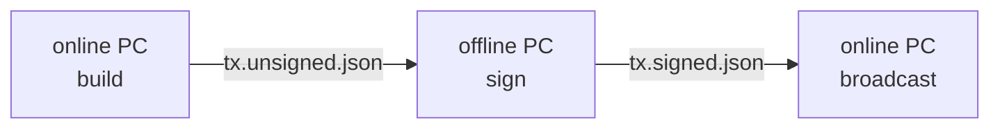

# 10. Команды `offline` (air-gap подпись)

Группа `monujo offline` реализует классический трёхшаговый сценарий
оффлайн-подписи для Tron-переводов (TRX и USDT TRC-20):

1. **online PC #1** — `offline build` собирает неподписанную транзакцию
   и записывает JSON-конверт.
2. **offline PC** — `offline sign` верифицирует и подписывает файл,
   используя зашифрованный keystore, который лежит **только** на этой
   машине.
3. **online PC #2** — `offline broadcast` ещё раз показывает поля
   транзакции, спрашивает подтверждение и отправляет её в сеть через
   gRPC.



## Изоляция ключа

Зашифрованный keystore-файл с приватным ключом находится только на
**offline-машине**. На online-PC, где выполняются `build` и
`broadcast`, его держать **не нужно** и не следует — иначе атакующий,
скомпрометировавший online-PC, сможет скопировать файл и пытаться
подобрать пароль офлайн.

- `offline build` принимает адрес отправителя через
  `--from-address T...` (публичный base58-адрес). Если на online-машине
  всё-таки лежит непустой keystore, можно использовать
  `--from-name <wallet>`: команда зарезолвит адрес через
  `keystore.ListWallets` без расшифровки.
- `offline sign` — единственная команда, которой нужен `--keystore-dir`
  и пароль keystore. Адрес из расшифрованного ключа сверяется с полем
  `from` в payload; при расхождении подпись не выполняется.
- `offline broadcast` снова не требует keystore.

## Окно жизни транзакции

Tron включает в `raw_data` поля `ref_block_*` и `expiration` (≈ 60 секунд
от момента сборки). Если за это время не успели подписать и
отправить, broadcast вернёт ошибку `TAPOS expired` — нужен новый
`build`. Это сознательное ограничение оффлайн-сценария: вы получаете
гарантии Tron'а, что транзакция нельзя «положить в стол» и отправить
через неделю.

## Защита от подмены файла при переносе

Между онлайном и оффлайном файл проходит через носитель, которому
нельзя полностью доверять (флешка, облако и т. п.). Применяются два
независимых уровня защиты:

1. **Визуальная сверка.** Перед подписью и перед broadcast monujo:
   - заново декодирует `raw_data` из payload и парсит контракт
     (TRX TransferContract или TRC-20 transfer(address,uint256));
   - сверяет получившиеся `from` / `to` / `amount` / `contract` /
     `expiration` с теми, что объявлены в payload — и **отказывается
     работать**, если значения расходятся;
   - печатает в stderr все поля плюс SHA-256 самого файла-конверта;
   - спрашивает `[y/N]` (или принимает `--yes`).
2. **HMAC-SHA256 (опционально).** Если задать
   `--hmac-passphrase` или `--hmac-passphrase-env <NAME>` на всех трёх
   командах, в конверт добавляется `hmac_hex` — HMAC-SHA256 от
   `payload_b64` на ключе `scrypt(passphrase, "monujo-offline-v1",
   N=32768, r=8, p=1, 32)`. На приёмнике HMAC сверяется до показа
   полей; при несовпадении файл отклоняется. HMAC защищает
   целостность, но **не секретность**: passphrase лучше передавать не
   через сам файл, а другим каналом (голосом, SMS, отдельным
   защищённым мессенджером).

## Формат файла-конверта

Один и тот же внешний JSON используется для unsigned и signed файлов;
HMAC покрывает строго те байты, что лежат на диске:

```json
{
  "monujo": "monujo-offline",
  "kind": "unsigned_transfer",
  "version": 1,
  "payload_b64": "<base64 канонической JSON-записи payload-структуры>",
  "hmac_alg": "scrypt+hmac-sha256",
  "hmac_hex": "<опционально>"
}
```

Сам payload — это строго упорядоченная JSON-структура (см.
`internal/transfer/envelope.go`):

- **UnsignedTransferPayload**: `version, chain, kind, from, to, amount,
  amount_minimal, contract, fee_limit_sun, raw_data_hex, expiration_unix_ms,
  timestamp_unix_ms, tx_id_hex, created_at_unix, note`. Подписывается
  `raw_data_hex` (protobuf `core.TransactionRaw`); все остальные поля
  служат для визуального контроля и должны совпадать с тем, что
  раскодируется из `raw_data_hex`.
- **SignedTransferPayload**: подмножество тех же полей плюс
  `signature_hex` (65 байт recoverable ECDSA, hex с префиксом `0x`).

## Пример: TRX

```bash
# online PC #1 (без keystore)
./monujo offline build \
    --from-address TMuA6YqfCeX8EhbfYEg5y7S4DqzSJireY9 \
    --to T9yD14Nj9j7xAB4dbGeiX9h8unkKHxuWwb \
    --kind trx --amount 12.5 \
    --out tx.unsigned.json \
    --hmac-passphrase-env MONUJO_HMAC

# offline PC (есть keystore, есть приватный ключ)
./monujo offline sign \
    --in tx.unsigned.json --name cold --out tx.signed.json \
    --hmac-passphrase-env MONUJO_HMAC
# > вводите пароль keystore, читаете распарсенные поля, отвечаете y

# online PC #2 (без keystore)
./monujo offline broadcast \
    --in tx.signed.json --hmac-passphrase-env MONUJO_HMAC
# > ещё раз поля, y → broadcast OK
```

## Пример: USDT (пополнение газа)

`offline` поддерживает USDT: укажите `--kind usdt` и сумму в
USDT-десятичных. По умолчанию `fee_limit_sun` берётся из конфигурации
монужи (опция `DefaultFeeLimitSun`, можно изменить через
`--fee-limit-sun`-флаг будущего расширения). На mainnet используется
канонический контракт `TR7NHqjeKQxGTCi8q8ZY4pL8otSzgjLj6t`, на Shasta —
тестовый токен.

```bash
./monujo offline build \
    --from-address T...cold --to T...recipient \
    --kind usdt --amount 25.50 \
    --out usdt.unsigned.json
```

## Подтверждения и `--yes`

`offline sign` и `offline broadcast` по умолчанию ждут ввода `y`/`yes`
в терминале. Для скриптов передайте `--yes`. Если стандартный ввод не
подключён к терминалу и `--yes` не указан, команда останавливается с
ошибкой (та же логика, что у `confirmWalletNetworkForOperation` для
`hot`-команд).

## Сети

`offline build` берёт сеть из глобального `--network` и зашивает её в
поле `chain` payload (`tron:mainnet` или `tron:shasta`). На стороне
`sign`/`broadcast` глобальная `--network` тоже обязательно должна
совпадать с `chain`, иначе команда отказывается работать. Это
дополнительная страховка против случайной отправки mainnet-перевода
через Shasta-узел.

## Ограничения

- USDT в офлайн-режиме покрывает только метод
  `transfer(address,uint256)` на канонический USDT-контракт текущей
  сети; иные TRC-20 / иные методы — вне scope этого милстоуна.
- Один файл — одна транзакция (один контракт в `raw_data`); пакетные
  переводы не поддерживаются.
- Нет «снапшота» ref-block для долгоживущей подписи: 60-секундное
  окно — это особенность Tron'а, не конфигурационный параметр.
