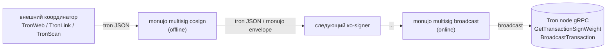

# 13. Команды `multisig` (участие в multisig-транзакциях Tron)

Tron поддерживает multisig нативно: у каждого аккаунта есть
`owner_permission` (id=0), опциональный `witness_permission` (id=1) и до
восьми `active_permission` (id=2..9). В каждой permission указан
`threshold` и список пар `{address, weight}`. Транзакция ссылается на
конкретную permission через `Transaction.Contract[i].Permission_id`; это
поле участвует в хэше, поэтому `txID = sha256(raw_data)` меняется при
смене permission. Каждый ко-signer **добавляет** свою подпись в
`Transaction.Signature`, пока их суммарный вес не достигнет `threshold`.

Группа `monujo multisig` реализует только **участие** в уже собранных
кем-то multisig-транзакциях: подписать, посмотреть статус и, если
`threshold` достигнут, транслировать. Сама транзакция и настройка
permissions (`UpdateAccountPermissionContract`) делаются внешним
координатором — TronWeb/TronLink/TronScan/CLI java-tron, — monujo про
эту сторону намеренно не знает.



## Формат файлов

Команды `cosign` / `broadcast` / `info` принимают и выдают два формата:

1. **Канонический Tron JSON** — тот же, что возвращает HTTP API Tron и
   `tronWeb.trx.multiSign`:

   ```json
   {
     "txID": "...",
     "raw_data": {...},
     "raw_data_hex": "...",
     "signature": ["<hex>", "<hex>", ...]
   }
   ```

   Valid/invalid `txID` проверяется против пересчитанного `sha256(raw_data_hex)`.

2. **Monujo sealed envelope** (`kind=multisig_transfer`) — base64-обёртка
   с SHA-256 fingerprint'ом и опциональным HMAC-SHA256 на passphrase.
   Используется при переносе файла между air-gap машинами: монитор на
   каждой стороне показывает fingerprint и человеко-читаемые поля (`from`,
   `to`, `amount`, `contract`, `fee_limit_sun`, `expiration`).

Флаг `--format auto|tron-json|monujo` задаёт формат входа. Если
пропущен, формат определяется автоматически: если у JSON есть ключ
`"monujo"` — это sealed envelope, иначе Tron JSON. Для `cosign`
отдельный `--out-format` позволяет поменять формат на выходе (например,
принять Tron JSON и вернуть `monujo` envelope для передачи на
air-gap-машину).

## Команды

### `monujo multisig cosign`

Offline. Принимает multisig-транзакцию, верифицирует `raw_data_hex`
против человеко-читаемых полей (для TRX и USDT — строгая сверка с
отказом при несовпадении; для прочих контрактов — предупреждение и
подтверждение), подписывает
ключом из keystore и записывает обновлённый файл. Отказывается ставить
вторую подпись тем же ключом — это случайная двойная подпись, которая в
Tron просто не увеличит вес — если не передан `--force`.

```bash
monujo multisig cosign \
  --in tx.json --out tx.cosigned.json \
  --addr alice \
  [--format auto|tron-json|monujo] [--out-format ...] \
  [--hmac-passphrase ... | --hmac-passphrase-env VAR] \
  [--yes] [--force] [--overwrite] [--note "для Acme LTD"]
```

Флаг `--addr` принимает имя кошелька в keystore **или** base58-адрес
(адрес резолвится через `keystore.ListWallets` без расшифровки; если
адрес не принадлежит ни одному локальному кошельку — команда выдаст
ошибку с просьбой передать имя). Preview перед подтверждением показывает
`permission_id` транзакции и адрес выбранного signer. Offline `cosign`
не может доказать, что signer входит в permission keys без обращения к
ноду; перед раздачей файлов сверяйте это через `watch permissions` или
онлайн `multisig info`. Совпадение keystore-сети с сетью из envelope
проверяется; `--force` обходит проверку (та же семантика, что в
`offline sign`).

`--out` не перезаписывается молча; для замены существующего файла
нужен явный `--overwrite`.

### `monujo multisig info`

Online read-only. Показывает, сколько подписей уже накоплено, threshold
и кто ещё должен подписать:

```bash
monujo multisig info --in tx.cosigned.json [--format ...] [--hmac-*]
```

Делает один gRPC вызов `GetTransactionSignWeight`; broadcast и подпись
не выполняются.

### `monujo multisig broadcast`

Online. Pre-check через `GetTransactionSignWeight` — если
`current_weight < threshold`, broadcast **не** выполняется, печатается
diff (кто уже подписал, кого ещё не хватает). Иначе транзакция
отправляется в сеть через стандартный `WriteClient`.

```bash
monujo multisig broadcast \
  --in tx.cosigned.json \
  [--format ...] [--hmac-*] [--yes]
```

`--yes` обязателен для неинтерактивных скриптов; как и в `offline
broadcast`, печать fingerprint и полей перед вызовом ноды совпадает
между машинами.

## Окно жизни транзакции

`raw_data.expiration` у Tron обычно ≈ 60 секунд от момента сборки. Для
multisig, где подписей несколько и файл бегает между машинами, это
жёсткое ограничение: если не уложились — координатор пересобирает
транзакцию, и все предыдущие подписи инвалидируются (меняется `txID`).
`monujo multisig info` показывает `expiration` в UTC/ISO 8601, чтобы
было видно, сколько окна ещё осталось.

## Non-goals

- Нет `monujo multisig propose` — новые multisig-транзакции собираются
  внешним координатором.
- Нет поддержки `UpdateAccountPermissionContract` — настройку permissions
  делает TronLink/TronWeb/другой инструмент.
- Не появляется новый HTTP-провайдер/gRPC-клиент: используются те же
  `ReadClient` и `WriteClient`, что и для `watch`, `hot`, `offline`.
- `offline build/sign/broadcast` **не** изменяются — они по-прежнему
  ровно про 1-of-1 транзакции.

## См. также

- [04. Команды `watch`](04-watch-commands.md) — `watch permissions`
  показывает permission-структуру аккаунта и помечает ключи, к которым у
  вас есть локальный keystore-кошелёк.
- [10. Команды `offline`](10-offline-commands.md) — аналогичный
  сценарий для 1-of-1 air-gap подписи.
